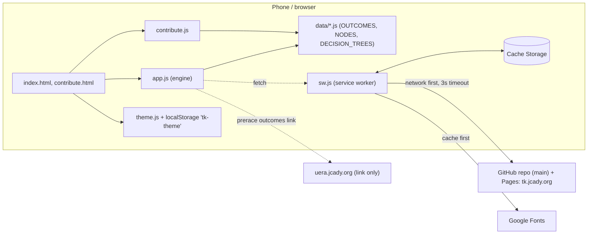
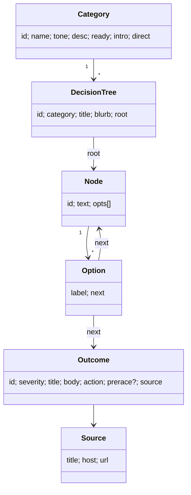
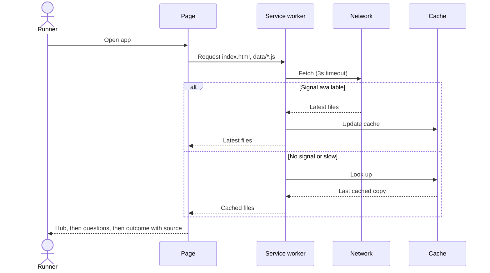
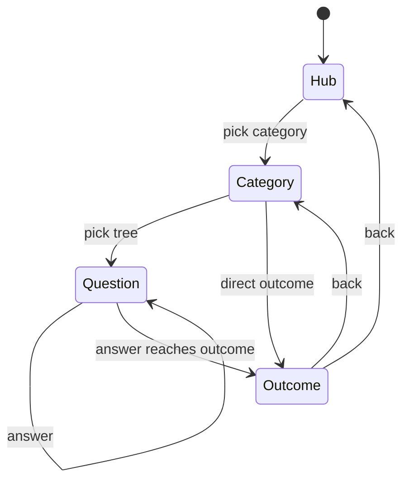
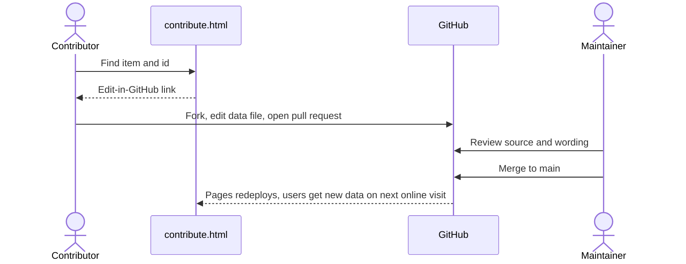
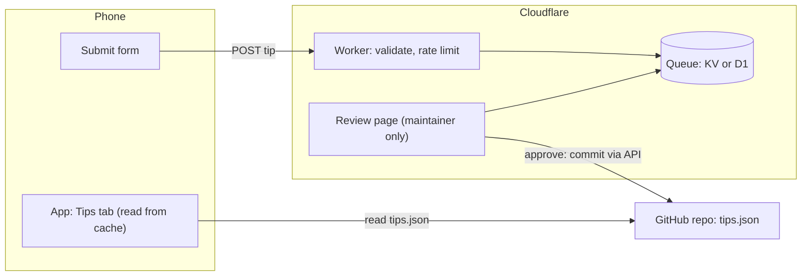
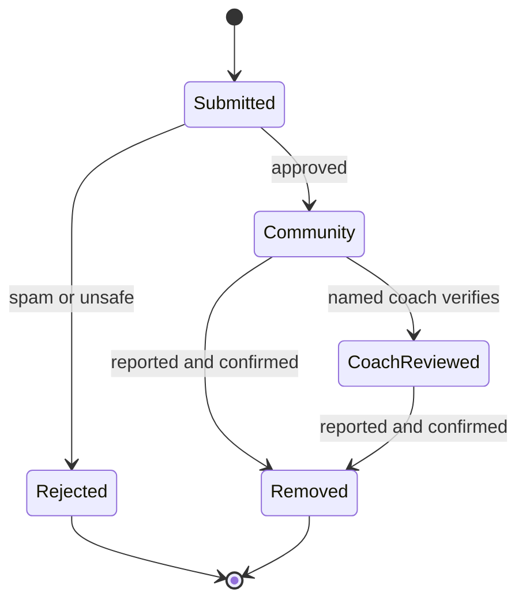
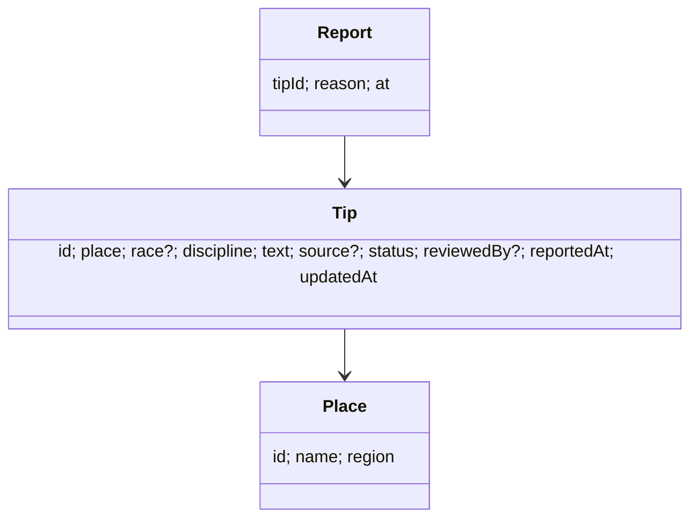

# Architecture

## Goals

1. Work with no signal once loaded (trail, race course, remote spot).
2. Let content improve without an app release.
3. Make every claim traceable to a source.
4. Let people contribute without writing code.
5. Stay free to host and easy to maintain.

## How it's put together

- **Static site.** No server, no database, no build step. HTML, CSS, and JavaScript served as files.
- **Data is code.** `data/*.js` defines `OUTCOMES`, `NODES`, and `DECISION_TREES`. The app renders them directly. Any tree can route into any node or outcome, so one question can be reached from several starting points without duplication.
- **One engine.** `app.js` renders the hub, category, question, and outcome screens from the data.
- **Contribution page.** `contribute.js` reads the same data files, so the public logic view can't drift from what the app shows.

## Data model

```
DECISION_TREES  →  root node  →  NODES (question, options)  →  node or OUTCOMES
                                       ↑                              │
                                       └──────── (any option) ────────┘
```

- Ids are the stable keys. Renaming an id breaks links from other pages.
- `PHYSICAL_IDS` (in `data/physical.js`) records which ids the physical file defines. The contribute page uses it to point each item at its home file.

## Offline and updates

- `sw.js` precaches the app shell and the data files on install.
- Data files (`/data/`) use **network-first**. When online, users get the latest content. When offline, they get the last cached copy.
- Everything else uses **cache-first**.
- `CACHE_VERSION` is bumped when shell files change, so old caches are cleared.
- The install is a PWA (`manifest.json`). iPhone: Share, then Add to Home Screen. Android: install prompt or the APK (see ANDROID.md).

## Diagrams

All diagrams are Mermaid and render on GitHub.

### Components (as built)



### Data model (as built)



### Sequence: opening the app on the trail



### Screen states



### Contribution flow (as built)



## Proposed: community tips (not built)

Status: **proposal for review.** Nothing here exists in the code yet. It extends the static design above without breaking offline use.

### Goals
- Let runners and coaches add place- and race-specific knowledge (courses, conditions, aid, gear) without using GitHub.
- Keep the app readable offline, and keep visitor privacy: reading stays anonymous and local.
- Show how each tip was checked, and never present unreviewed tips as verified.

### Design
- **Tips are data, not code.** A published `tips.json` is read by the app and cached by the service worker like `data/*.js`. Offline reading is unchanged.
- **Submissions go to a small backend** (Cloudflare Worker + KV or D1), separate from the static site. The app only needs it for submit, helpful and report actions, not for reading.
- **Review before publish.** Submissions land in a queue. A maintainer approves, edits or rejects. Approval publishes to `tips.json` (via the GitHub API, same pattern as the UERA partners Worker). A "coach-reviewed" label requires a named reviewer.
- **Abuse controls:** rate limit per IP, length limits, no links in tip text unless a source field, report button, takedown by maintainer, spam trap field.
- **Privacy:** no accounts for v1. Submitter email is optional, used only to confirm, and deleted after review. State this on the submit form.
- **Hosting:** GitHub Pages can keep serving the static app. The Worker is a new Cloudflare resource (see Hosting below).







### Open decisions
1. Whether tips are tied to a race, a place, or both for v1.
2. Who the named coach reviewers are, and what "reviewed" promises.
3. Whether submitters need any identity beyond an optional email.
4. Moderation rules for safety-critical tips (water crossings, heat, navigation): route to a maintainer, never auto-publish.
5. Whether this lives inside tk.jcady.org or as a new tab with its own Worker (recommended: same app, new tab).

## Testing

`scripts/check-content.js` checks the data:

- Every `next` resolves to a node or an outcome.
- Every outcome has a title, body, action, and a source URL.
- Every node is reachable from some tree.
- Every tree has a category.
- Every path through every tree renders without errors.

## Hosting

**Current:** GitHub Pages, `main` branch, custom domain `tk.jcady.org` (`CNAME`).

Why it works now: free, no server to run, pull requests are the review step, and the contribution flow already sends people to GitHub.

**If we add features that need a server** (reviewer queue, submission form, analytics, Android app-link verification with custom headers), the options are:

| Option | Fits | Notes |
|---|---|---|
| Keep GitHub Pages | Static content and GitHub-based contributions | Cannot set custom headers. Android `assetlinks.json` works if the file is served as-is. Simplest. |
| Cloudflare Pages | Static site with deploy previews, custom headers, and optional Functions for a small backend | Free tier is generous. Preview URLs make review easier. Connects to Cloudflare tools we already have in this environment. |
| Cloudflare Pages + Functions + D1 | A moderated submission queue, reviewer accounts, analytics | Adds a database to maintain. Only needed when the GitHub flow isn't enough. |

**Recommendation:** stay on GitHub Pages for now, since it matches the GitHub-only contribution decision and costs nothing. Move to Cloudflare Pages when we need custom headers or a submission queue. The move is mostly a DNS change and a Pages project, and the content files don't change.

## Security notes

- Nothing the user types is stored or sent. The app is read-only for visitors.
- The contribute page only links to GitHub. It doesn't collect data itself.
- Content comes from the repo. Anyone can propose a change, but nothing merges without review.
- No third-party scripts. Fonts come from Google Fonts (cached by the service worker).
